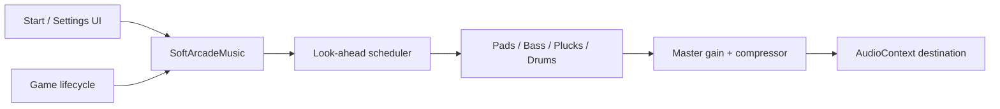

# Soft Arcade music integration

## What this package contains

```text
soft-arcade-integration/
├── SoftArcadeMusic.js
├── integration-example.js
├── AGENT_IMPLEMENTATION_PROMPT.md
└── README.md
```

`SoftArcadeMusic.js` synthesises the complete soundtrack at runtime using the Web Audio API. There is no MP3/WAV dependency.

## Manual integration

1. Copy `SoftArcadeMusic.js` into the game's audio or effects folder.
2. Import and create one instance:

```js
import { SoftArcadeMusic } from './audio/SoftArcadeMusic.js';
const gameMusic = new SoftArcadeMusic({ volume: 0.55 });
```

3. Start it after a real click/tap:

```js
startButton.addEventListener('click', async () => {
  await gameMusic.start();
  startGame();
});
```

4. Wire existing controls:

```js
gameMusic.setVolume(0.35);
await gameMusic.stop({ fadeSeconds: 0.4 });
```

## Why the loop is seamless

The composition is 24 bars at 96 BPM, therefore one cycle is exactly 60 seconds. The module schedules each next cycle ahead of time against the `AudioContext.currentTime` clock. It does not wait for an HTML audio `ended` event and does not stop/restart at the boundary.

## Important implementation rules

- Maintain one instance only.
- Call `start()` from a user gesture.
- Do not invoke `start()` per level or per animation frame.
- Use `setVolume()` rather than changing internal gain nodes.
- Use `stop()` when music is disabled; it includes a short fade.
- Test at least five cycles to catch stacking or lifecycle issues.

## Architecture


